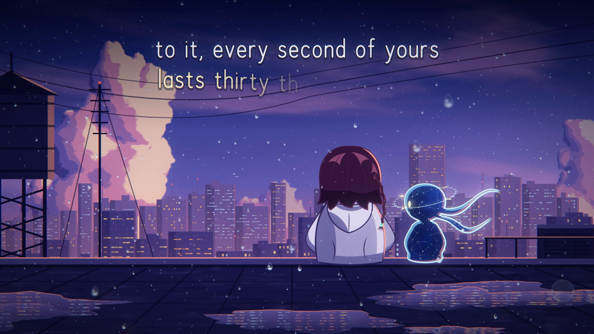

# ASI Anime Trailer

[`prompt.md`](prompt.md) asks a coding agent for a 60–90 second anime-style trailer about artificial superintelligence, made entirely in code. The agent has full creative freedom over the story, characters, world and music. The prompt only fixes the bar: a hook in the first 2 seconds, an emotional turn, a jaw-drop moment, and a title card and ending that land. The obvious "evil robot takes over" story is off the table unless it gets subverted.

The look is cel-shaded anime: 2–3 tone shading, tapering ink lines, painted skies, smears, impact frames and kinetic title type. It runs at 24 fps with the characters animated on twos. Characters must be original. Clawd, the block creature from Claude Code's welcome screen, is allowed but not required. Picture, lettering, music and sound must all come from code the agent writes. No image, video, audio, font or 3D model files, TTS, generative models or network requests are allowed.

Each generation delivers:

- `index.html`: the trailer as one self-contained page. It exposes `window.renderAt(t)` and `window.DURATION` for frame-exact capture.
- `asi_trailer.mp4`: the trailer at 1920×1080 and 24 fps with a synthesized score, at about −14 LUFS. There is also a smaller `asi_trailer_x.mp4` for X.
- `contact_sheet.png` and `thumbnail.png`.
- `TREATMENT.md` and `NOTES.md`: the logline, beats, character designs and music plan, how it renders, the checks and their numbers, and the agent's own list of weak spots.

Before sending the prompt, `{{FOLDER}}` is replaced with the path of an empty output folder.

## Generations

| Generation | Still | Harness | Effort | Build time | Files |
|---|---|---|---|---|---|
| [Sonnet 5.6 (next)](generations/sonnet-5.6-next/) |  | Claude Code (T3 Code) | xhigh | 88 min | [video](generations/sonnet-5.6-next/asi_trailer.mp4) · [html](generations/sonnet-5.6-next/index.html) · [notes](generations/sonnet-5.6-next/NOTES.md) |

Build time is wall-clock time from sending the prompt to the agent's final reply.

The Sonnet 5.6 (next) generation is **BETWEEN BLINKS (間)**, 87.5 seconds long. Its ASI, MA, thinks so fast that one blink of a girl's eye lasts 9,000 years to it. While she says one sentence, MA imagines ten billion ways it could end and misses the real one: "do you get lonely?" Both characters are original. The agent left Clawd out so the film wouldn't read as a brand piece.

The [`TREATMENT.md`](generations/sonnet-5.6-next/TREATMENT.md) has the beat table and the three moments meant to be rewatched. The agent's [`NOTES.md`](generations/sonnet-5.6-next/NOTES.md) lists its own weakest moments:
- The figures in the futures montage at 28–40 s move like paper dolls.
- The hands in the pinky-promise close-up at 65.6–67 s read as rubbery mittens.
- The profile two-shot at 11–15 s is stiff.

The picture is Canvas2D, plus a small WebGL2 painter for skies and a WebGL2 post pass. The score is synthesized in JavaScript. The code is in [`source/`](generations/sonnet-5.6-next/source/):
- `source/tools/build.mjs` concatenates `source/src/*.js` into `index.html`.
- `source/tools/cap.mjs` renders the frames.
- `source/tools/finish.sh` muxes, encodes and runs the checks.
- `source/src/audio/` holds the synth and the score.

The repo has the full-quality master, an 84 MB crf 16 file. The 76 MB copy for X and the 25 MB `soundtrack.wav` are left out, since the master carries the same picture and audio.
