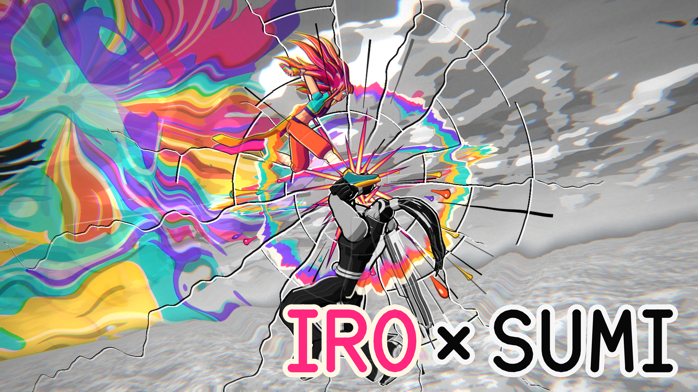

# Color vs. Monochrome Fight

[`prompt.md`](prompt.md) asks a coding agent for an extremely cinematic 50-second anime fight between two original characters, made entirely in code. One fighter is in full colour; the other has no colour at all, only black, white and greys, like living ink.

The prompt's priority is **impact**. Every hit must feel insanely heavy and destructive. It asks for:
- anticipation, contact and follow-through on every big hit
- a hit-stop: both fighters freeze for 2–8 frames while debris and shockwaves keep moving
- impact frames, directional camera shake, crash zooms, time ramps and shockwaves that distort the picture
- destruction that escalates and never resets, from a wall to a street, a building and the ground itself
- a hit list of at least 10 major impacts, rising in scale, with 3 hero impacts and a final hit far bigger than the rest
- layered sound for every hit (crack, sub thump, material layer, debris tail), with the music ducked and each transient within ±1 frame of its contact frame, checked by an audit

The colour-versus-monochrome rule is the agent's own design, but it must stay consistent and readable in every frame.

Picture, lettering, music and sound must all come from code the agent writes. No image, video, audio, font or 3D-model files, generative models, libraries, network requests or subagents are allowed.

Each generation delivers:
- `index.html`: the film as one self-contained page, exposing `window.DURATION` and `window.renderAt(t)`
- `fight.mp4`: exactly 50.0 s (1,200 frames) at 1920×1080 and 24 fps, with a synthesized score at about −14 LUFS; plus a smaller `fight_x.mp4` for X
- `character_sheet.png`, `impact_sheet.png` (frames −8 to +16 around each hero impact), `contact_sheet.png` and `thumbnail.png`
- `TREATMENT.md` and `NOTES.md`: the colour rule, the designs, the beats, the hit list with frame numbers, the checks and their numbers, and the agent's own weak spots

Before sending the prompt, `{{FOLDER}}` is replaced with the path of an empty output folder.

## Generations

| Generation | Still | Harness | Effort | Build time | Files |
|---|---|---|---|---|---|
| [Sonnet 5.6 (next)](generations/sonnet-5.6-next/) |  | Claude Code (T3 Code) | xhigh | 140 min | [video](generations/sonnet-5.6-next/fight_x.mp4) · [html](generations/sonnet-5.6-next/index.html) · [notes](generations/sonnet-5.6-next/NOTES.md) |

Build time is wall-clock time from sending the prompt to the agent's final reply.

The Sonnet 5.6 (next) generation is **IRO × SUMI**:
- **IRO** is colour: whatever she hits turns to her paint and stays painted. **SUMI** is ink: whatever he hits is stamped black, white and grey, and any paint there is drained.
- The world starts grey, and debris, shockwaves and dust always wear the colour of whoever caused them.
- IRO stays screen left and SUMI screen right for the whole fight, so a hit's direction tells you whose it is.
- In the climax SUMI drains the whole world to ink, and the two signature moves meet at **45.17 s (frame 1084)**. About half a second of near silence leads into an 8-frame hit-stop and 3 impact frames, and the blast wipes out the skyline.
- The final shot is an ensō, a one-stroke brush circle: his ink makes the shape, and her colour fills it.

It has 13 major hits and 17 minor ones (see the hit list in [`NOTES.md`](generations/sonnet-5.6-next/NOTES.md)). The sync audit puts all 13 major hits at 0.00 ms from their contact frames and all 17 minor ones within 0.27 ms, and a copy with the audio delayed by 2 frames fails all 30. Flashes peak at 3 in one second, which is the limit. Across 136 million checked SUMI pixels, none is off-grey by more than 8/255.

The agent's own weakest moments:
- At 17.3–18.8 s, the storefront rubble looks like painted toy blocks, SUMI gets lost in it, and the two wall smashes don't read as separate hits.
- At 25.0–26.6 s, both fighters are small against busy rubble, so it's hard to see who is holding whom.
- At 19.8–20.8 s, the street split is half hidden by noisy rubble and doesn't feel clearly bigger than the hit before.

It also notes that the fighters read more like cel-shaded 3D than hand-drawn anime. It left out battle cries because it couldn't hear them; the only voice-like sound is breathing in the lull.

The fighters are 3D skeletons with two-bone IK and lofted meshes rebuilt for each drawing, cel shaded with tapering ink lines. Close-ups and lettering are 2D vector drawings. The debris is 6,450 rigid pieces simulated once at load. The score is synthesized in numpy at 144 BPM, and one hit table drives both the picture timing and the sound. The code is in [`src/`](generations/sonnet-5.6-next/src/) and [`tools/`](generations/sonnet-5.6-next/tools/), about 8,900 lines, and [`checks/`](generations/sonnet-5.6-next/checks/) holds the audit reports.

The repo has the 52 MB copy for X. The 261 MB crf 16 master, the soundtrack WAV and the per-hit check clips are left out.
