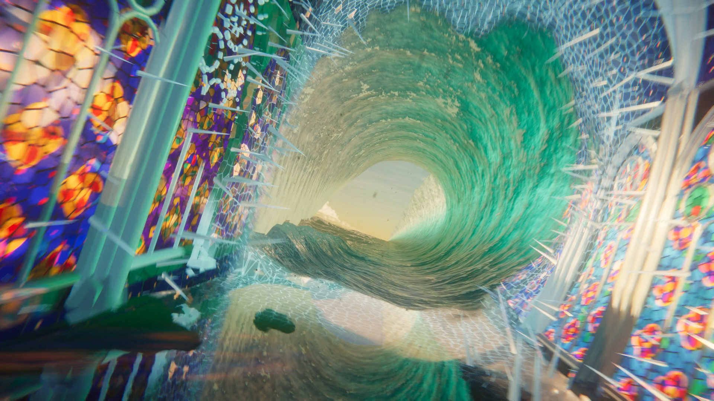

# Creates Everything

[`prompt.md`](prompt.md) asks a coding agent for a 55-second film about itself, made entirely in code. It is one unbroken shot in which the model types short lines of real code and the world obeys:

1. A storm sea detonates out of a black mirror.
2. A barrel wave freezes into a stained-glass cathedral.
3. A day passes through the nave, and the rose window shatters into a flock of glass birds.
4. A city rises from the sea, and gravity is flipped live.
5. The city's lights become a galaxy.
6. Everything collapses into a single point, which turns out to be the blinking cursor. It types "I'm Opus. What should we make?"

The prompt fixes the typed lines, their timings, the beats and the techniques. Picture, models, lettering, music and sound must all be generated by code the agent writes. No image, video, audio, font or 3D model files, generative models or network requests are allowed.

Each generation delivers:

- `index.html`: the film as one self-contained page. It exposes `window.renderAt(t)` and `window.DURATION` for frame-exact capture.
- `opus55_creates.mp4`: the film at 1920×1080, 60 fps, exactly 55 seconds, with a synthesized soundtrack. There is also a smaller `opus55_creates_x.mp4` for X.
- `NOTES.md` and `TREATMENT.md`: the agent's shot list, the exact code typed, how it rendered, the checks it ran, and its own list of weak spots.

Before sending the prompt, `{{FOLDER}}` is replaced with the path of an empty output folder.

## Generations

| Generation | Still | Harness | Effort | Build time | Files |
|---|---|---|---|---|---|
| [Opus 5.5 (Claude Code)](generations/opus-5.5-claude-code/) |  | Claude Code | xhigh | 152 min | [video](generations/opus-5.5-claude-code/opus55_creates_x.mp4) · [html](generations/opus-5.5-claude-code/index.html) · [notes](generations/opus-5.5-claude-code/NOTES.md) |

Build time is wall-clock time from sending the prompt to the agent's final reply.

The Opus 5.5 generation renders with a WebGPU path renderer the agent wrote from scratch, about 2,500 lines of JavaScript and WGSL, with no three.js or any other library. Its soundtrack is synthesized by a Python script that uses only numpy. That code is in [`source/`](generations/opus-5.5-claude-code/source/): `index.html` is built from `source/src/`, and the soundtrack comes from `source/tools/score2.py`. The video in the repo is the 54.5 MB copy for X, because the full-quality master (crf 16, 388 MB) is too large for GitHub.
