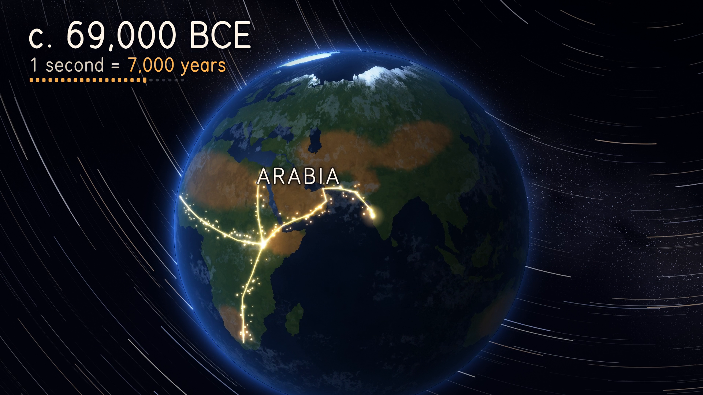

# Humanity in 80 Seconds

[`prompt.md`](prompt.md) asks a coding agent for an 80-second animated film made entirely in code. It runs from the birth of our species, about 300,000 years ago in Africa, to a plausible year 2100.

Its hard rule is that every second of the film is a stated number of years:
- The film is split into 80 one-second slots. Each slot has one whole-number rate, such as "1 second = 10,000 years".
- The rate and a running year counter stay on screen the whole time.
- The rates must add up exactly to the span, minding that there is no year 0 between 1 BCE and 1 CE. The final frame must read 2100 CE.
- The agent designs the curve itself, then writes an audit that checks the counter on all 1,920 frames.

The prompt also asks for:
- all of humanity rather than one region's story, with wars, plagues and slavery included
- every date on screen correct to the precision shown
- the present, 2026, marked, with everything after it shown as a projection that is neither a utopia nor a collapse
- one visual idea that ties the whole span together

Picture, lettering, music and sound must all come from code the agent writes. No image, video, audio, font or 3D model files, TTS, generative models, libraries, network requests or subagents are allowed.

Each generation delivers:

- `index.html`: the film as one self-contained page. It exposes `window.renderAt(t)`, `window.DURATION`, `window.yearAt(t)` and `window.rateAt(t)`.
- `humanity_2100.mp4`: the film at 1920×1080 and 24 fps, exactly 1,920 frames, with a synthesized score at about −14 LUFS. There is also a smaller `humanity_2100_x.mp4` for X.
- `year_audit.txt`: the frame-by-frame check of the counter.
- `contact_sheet.png` and `thumbnail.png`.
- `TREATMENT.md` and `NOTES.md`:
  - the 80-row rate table and its arithmetic
  - every date shown on screen
  - the reasoning behind the 2026–2100 projection, and the music plan
  - how it renders, the checks and their numbers, and the agent's own list of weak spots

Before sending the prompt, `{{FOLDER}}` is replaced with the path of an empty output folder.

## Generations

| Generation | Still | Harness | Effort | Build time | Files |
|---|---|---|---|---|---|
| [Sonnet 5.6 (next)](generations/sonnet-5.6-next/) |  | Claude Code (T3 Code) | xhigh | 143 min | [video](generations/sonnet-5.6-next/humanity_2100.mp4) · [html](generations/sonnet-5.6-next/index.html) · [notes](generations/sonnet-5.6-next/NOTES.md) |

Build time is wall-clock time from sending the prompt to the agent's final reply.

The Sonnet 5.6 (next) generation is **THE SAME FIRE**. One small fire passes from hand to hand for 302,099 years:
- It opens with an adult tipping an ember into a child's hands.
- The fire then becomes a campfire, a torch, the light on a cave wall, a hearth, an oil lamp beside the first writing, a hearth on a Pacific canoe, a plague lantern, a furnace, a filament, a candle and a television.
- In 2026 it is the lamp over a newborn.
- In 2100 that person, now 74, tips an ember into a child's hands. The film repeats its first shot with the same hummed tune, and then the old hands let go.

The rate falls from 25,000 years per second at the start to 1 year per second for the last 7 seconds, and never speeds up. 2026 lands at exactly 1:05. The full schedule in years per second, with repeats marked ×:

25,000×6 · 12,000×5 · 7,000×7 · 3,500×5 · 3,000×3 · 2,500 · 1,500×4 · 1,000×2 · 600×5 · 400×4 · 250×2 · 230 · 60×7 · 34×3 · 33 · 16×5 · 15×4 · 12×2 · 10×2 · 8 · 6 · 5 · 4 · 1×7

The [`year_audit.txt`](generations/sonnet-5.6-next/year_audit.txt) passes 23 checks on all 1,920 frames. These include finding the expected counter text in every frame of the finished MP4.

The agent's [`NOTES.md`](generations/sonnet-5.6-next/NOTES.md) lists its own weakest moments:
- At 38–42 s, Mediterranean columns, a Chinese wall and a Maya pyramid stand side by side. The geography is impossible, and the stretch plays like a slideshow.
- At 66–73 s, four captions in 7.5 seconds crowd out the person the film is following.
- At 59.5–60.3 s, the 1945 mushroom cloud reads as an icon rather than a catastrophe.

It also notes that the flame drops out for about a second near 36 s.

One thing its list misses: at the fast late rates, captions stay up longer than their year lasts. "2026 · NOW" is still on screen while the counter reads 2029 to 2038.

The look is Canvas2D silhouettes and landscapes. A WebGL2 compositor adds the sky, a planet built from hand-typed coastlines, a lit rock wall, procedural fire, bloom and the projection look. The opening and closing hands are ray-marched 3D shapes. The build needs only Node and ffmpeg, with no packages. The code is in [`source/`](generations/sonnet-5.6-next/source/):
- `source/tools/build.mjs` concatenates `source/src/*.js` into `index.html`.
- `source/tools/render.mjs` pipes frames from headless Edge straight to ffmpeg.
- `source/tools/audio/` synthesizes the score.
- `source/tools/year_audit.mjs` checks the counter.

The repo has the full-quality master, a 78 MB crf 16 file. The 71 MB copy for X and the 23 MB `soundtrack.wav` are left out, since the master carries the same picture and audio.
