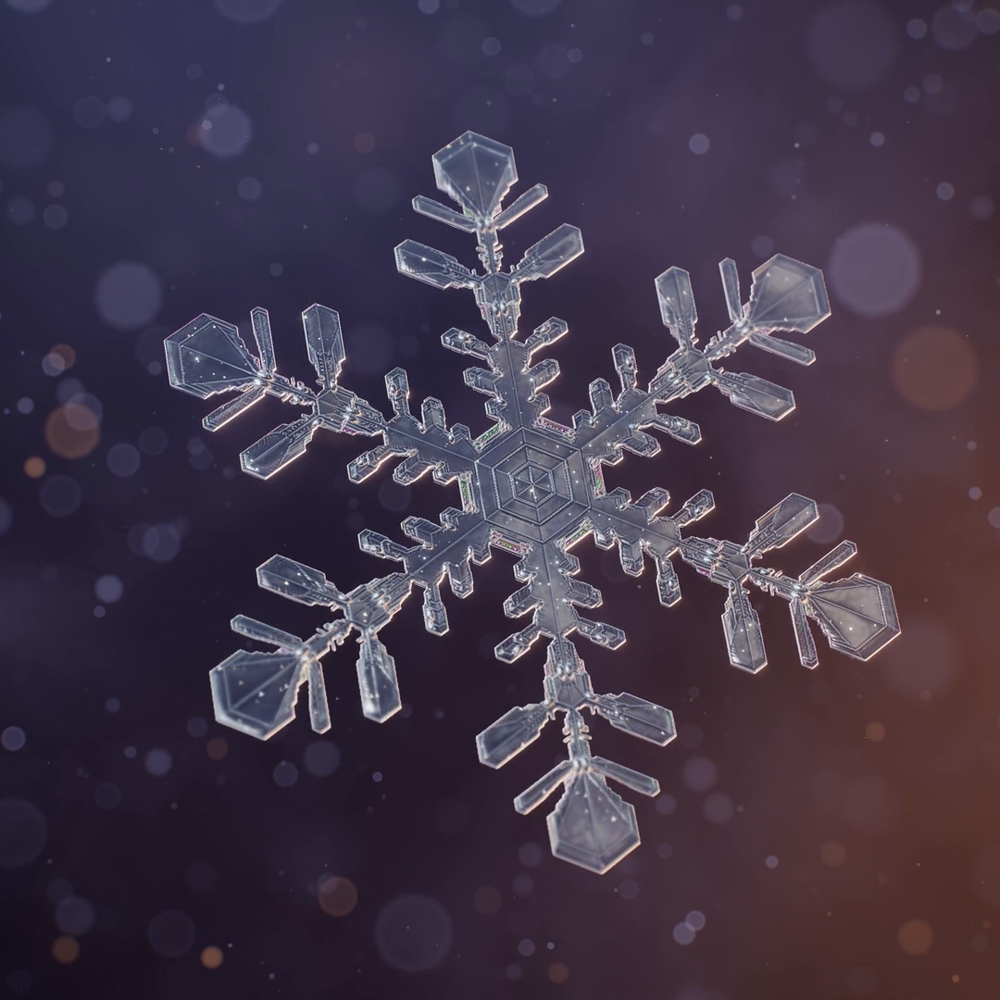

# The Life of a Snowflake

[`prompt.md`](prompt.md) asks a coding agent for a 20-second film in one three.js HTML file: the complete life of one snowflake, from a speck of dust to landing on a dark wool mitten. The crystal's shape is a diary of the air it fell through, and its growth must follow real ice physics:
- the habits of the Nakaya diagram: plates, needles and columns, and stellar dendrites near −15 °C in very humid air
- a real diffusion-limited growth simulation on a hexagonal lattice, in the spirit of the Gravner–Griffeath model, driven by a scripted temperature and humidity timeline rather than a morphing drawing
- six identical arms, because all six live through the same history
- a final shape that plainly records every stage it grew through: plate, arms, side branches, sectored tips, a ridged centre and trapped air bubbles
- glassy macro ice with refraction and thin-film colour, a dusk pine valley, and crisp, fuzzy wool
- a delicate, crystalline soundtrack: wind in the cloud, glassy chimes for each growth stage, muffled snowfall and a tiny tick at touchdown

The picture and the sound must be generated in code, and three.js is the only dependency allowed.

Each generation delivers:
- `snowflake.html`: the film as one self-contained page. With `?render=1` it exposes `window.renderAt(t)` for frame-exact capture.
- `snowflake.mp4`: the silent film, exactly 20.0 s (600 frames) at 1080×1080 and 30 fps. `snowflake-sound.mp4` is the same picture with the soundtrack.
- `stills/`: 4 frames from the film.
- `audio/`: the soundtrack's source and its checks.
- `NOTES.md`: the agent's notes on what it built, the physics, the render command, the cue sheet and how long it took.

Before sending the prompt, `{{FOLDER}}` is replaced with the path of an empty output folder.

## Generations

| Generation | Still | Harness | Effort | Build time | Files |
|---|---|---|---|---|---|
| [Sonnet 5.6 (next)](generations/sonnet-5.6-next/) |  | Claude Code (T3 Code) | xhigh | 134 min | [video](generations/sonnet-5.6-next/snowflake-sound.mp4) · [html](generations/sonnet-5.6-next/snowflake.html) · [notes](generations/sonnet-5.6-next/NOTES.md) |

Build time is wall-clock time from sending the prompt to the agent's final reply. This generation got the prompt in two messages: the soundtrack brief arrived while the final film render was running. That makes 116 minutes for the film and about 18 for the sound (see [`generation.json`](generations/sonnet-5.6-next/generation.json)).

The Sonnet 5.6 (next) generation is **Diary of a Snowflake**:
- **The growth is simulated.** The page grows 65 crystals with the Gravner–Griffeath lattice model in Web Workers when it loads. The hero crystal runs 73,760 steps to a radius of 422 cells, and each growth ring maps to one layer of air in the script.
- **The script reads like a diary:** a plate with two hexagonal ribs from dry pockets, six arms, side branches in a humidity spike, small waist plates in a dry layer, a second round of branching after an updraught, then sectored plates and faceted rims as the air dries.
- **The bubbles come from the lattice too.** Where and when the air bubbles appear comes from cells that closed late or froze as thin skins.
- **The ending:** the flake falls out of the cloud over a dusk pine valley with 15,089 trees, and lands on a knitted mitten among dozens of other crystals, all different.

Checks the agent ran:
- Six-fold symmetry on the full unfolded lattice (216,193 ice cells).
- 32 frames re-rendered out of order with no pixel mismatches, and all 600 frames unique.
- No NaN pixels and no single-frame flicker.

What it says is *not* simulated, so nothing is overclaimed:
- **Thickness:** it is mapped from the lattice's ice mass and freeze time, not solved along the crystal's c-axis.
- **Nucleation:** the droplet, freezing front and faceting in the first 3.8 s are an animated shape.
- **Columns and needles** are analytic prisms, and the bubbles are drawn shapes placed by the lattice.
- **The rest is directed:** the tumble, camera, lighting and fall speed.

The soundtrack is seeded synthesis in code, with a new sound for each growth stage, including a six-note arpeggio as the arms sprout. All 24 clearly detectable hits land within 3.4 ms of their cues. The mix is −16.1 LUFS with a −3.3 dBTP peak. The agent couldn't listen to it, and says a person should before it's posted. Five of its seven tiny bubble sounds may be too quiet to hear, and the low end is still fairly strong.

The code is in [`work/src/`](generations/sonnet-5.6-next/work/src/), with the build, render, check and test scripts in [`work/`](generations/sonnet-5.6-next/work/) and the sound in [`audio/`](generations/sonnet-5.6-next/audio/).

The repo leaves out the soundtrack WAV, because `snowflake-sound.mp4` carries the same mix.
