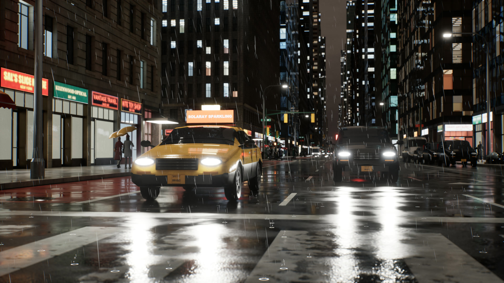

# New York in Unreal

[`prompt.md`](prompt.md) asks a coding agent to build an ultra-realistic replica of a piece of Manhattan in Unreal Engine 5.8, as a real Unreal project, and then make everything in it destroyable.

The agent makes everything itself, in code or in Unreal's own tools:
- the street grid, buildings, cars and traffic
- street furniture, materials and textures
- about 2,000 pedestrians with a real walking gait
- the sky, the weather, the effects and the sound

No downloaded or pre-made content is allowed: no Fab, Megascans, City Sample, MetaHumans, Mixamo or mocap, HDRIs, photos, sound files or generative models.

The prompt asks for:
- **Lighting and weather:** Lumen with hardware ray tracing, MegaLights at night, and one weather controller for time of day, clouds, rain, snow, fog, wetness, wind and lightning, with continuous transitions.
- **Pedestrians:** jointed winter-dressed walkers with heel-to-toe gait, measured foot slip, crossings on the signal, avoidance and umbrellas, within a stated GPU and game-thread budget.
- **Destruction:** Chaos Destruction everywhere, with structural collapse that cascades into neighbouring buildings. It also asks for at least 80 distinct tools, from a firecracker to world-ending, with the top five needing travelling shockwaves and real mushroom clouds.
- **Realism:** nothing that looks like cardboard. That means real wall and slab thickness, real densities, weathering, heavy self-shadowed dust, and a check of every low-sun shot for z-fighting and shimmer.
- **Play mode:** you fly the city, switch the weather, pick and fire any tool, reset, and toggle pedestrians. It must hold 60 fps at 1440p.
- **No people in destruction:** pedestrians fade out on the first use of a tool, and the destruction film shows no people.

Each generation delivers:
- `NYC/NYC.uproject`, the project, with the agent's build scripts and source in `source/`
- `nyc_film.mp4`, a 60–90 second 4K city film through a weather and time arc, with synthesized sound
- `nyc_destruction.mp4`, a 60–90 second 4K film escalating from the smallest tool to the biggest
- 1080p copies of both films for X
- 12+ 4K stills, `contact_sheet.png`, `gait_sheet.png` and `destruction_sheet.png`, from an audit that fires every tool
- `PLAN.md`, `DESTRUCTION.md` (every tool, numbered smallest to biggest) and `NOTES.md` (how it was built, checks, frame rates and the agent's own weak spots)

Before sending the prompt, `{{FOLDER}}` is replaced with the path of an empty output folder.

## Generations

| Generation | Still | Harness | Effort | Build time | Files |
|---|---|---|---|---|---|
| [Sonnet 5.6 (next)](generations/sonnet-5.6-next/) |  | Claude Code (T3 Code) | xhigh | 756 min | [city film](generations/sonnet-5.6-next/nyc_film.mp4) · [destruction film](generations/sonnet-5.6-next/nyc_destruction.mp4) · [notes](generations/sonnet-5.6-next/NOTES.md) · [tools](generations/sonnet-5.6-next/DESTRUCTION.md) |

Build time is wall-clock time from sending the prompt to the agent's final reply.

### Sonnet 5.6 (next)
The Sonnet 5.6 (next) generation builds Midtown around 5th Avenue and 42nd Street:
- 24 named landmarks, among them the New York Public Library with its lions, Bryant Park, Grand Central, the Chrysler and Empire State Buildings and One Vanderbilt
- 2,284 detailed buildings and 35,425 distant ones out to New Jersey, Queens and Brooklyn
- 2,120 pedestrians in 16 winter outfits
- a real solar position for the date

**The city film** follows one December day: clear afternoon → golden hour → sunset → overcast dusk → rain → thunderstorm → fog → night snow → snowy sunrise down 42nd Street → clear morning.

**The destruction film** escalates through 95 tools in 8 tiers, from a slingshot pebble to an asteroid ([`DESTRUCTION.md`](generations/sonnet-5.6-next/DESTRUCTION.md)). How it works:
- Buildings fail floor by floor in a structure solver, and Chaos simulates the pieces.
- The film plays back recorded Chaos caches, so renders repeat frame for frame.
- [`destruction_sheet.jpg`](generations/sonnet-5.6-next/destruction_sheet.jpg) shows a before and after for every tool.

**Pedestrians** are 16 jointed bodies with 25 bones and 4 LODs each.
- Each footprint is fixed in world space from heel strike to toe-off, and two-bone IK solves the legs.
- The CPU poses only the walkers that are drawn. The material skins instanced meshes from a bone texture.
- Each walker's state is a pure function of time.
- Foot slip averages 0.019 cm per ground contact.
- The agent says they hold up from about 4 m, so the city film keeps people at least 9 m from low cameras.
- The gait sheet is [`gait_sheet.png`](generations/sonnet-5.6-next/gait_sheet.png).

**Checks:**
- Both films decode clean at −14.2 LUFS with no clipping.
- The city film peaks at 2 lightning flashes in any second. The destruction film has no full-frame flashes.
- In Play mode at 1440p, flying runs at 66–97 fps and the wrecking ball at 66. The gas main reaches 57 fps and the tactical nuke 25, so the 60 fps target isn't met for the biggest tools.

The agent's [`NOTES.md`](generations/sonnet-5.6-next/NOTES.md) lists its own weakest moments:
- In the city film:
  - On Fifth Avenue toward the Empire State, the library glows for the first half second, and a glass tower's reflection reads as a blotchy gold mosaic.
  - The rooftop at dusk looks like a set.
  - The fog is one even veil instead of layered low cloud.
- In the destruction film:
  - The wrecking ball reads as a small hit.
  - The sledgehammer blows are small in frame.
  - The tornado looks more like a column of dark smoke than a funnel.

It also notes:
- At sunrise, one ribbon-window building still glints along its window heads.
- Faces and hands look like game characters closer than about 4 m.
- Large fragments can still look like flat cartons.
- Nuclear-class tools hitch at detonation.

The repo copy:
- **Films:** 1920×1080 re-encodes of the 4K masters, about 8 Mbit/s with the masters' audio. The 4K masters and the agent's X copies are each over GitHub's 100 MB limit.
- **Stills:** downscaled to 1920 px JPEG.
- **Source:** the agent's code is in [`source/`](generations/sonnet-5.6-next/source/), [`NYC/`](generations/sonnet-5.6-next/NYC/) (the `.uproject`, C++, shaders and config) and [`tools/`](generations/sonnet-5.6-next/tools/). The Unreal `Content` folder is left out, since `source/pipeline.py` regenerates it.
