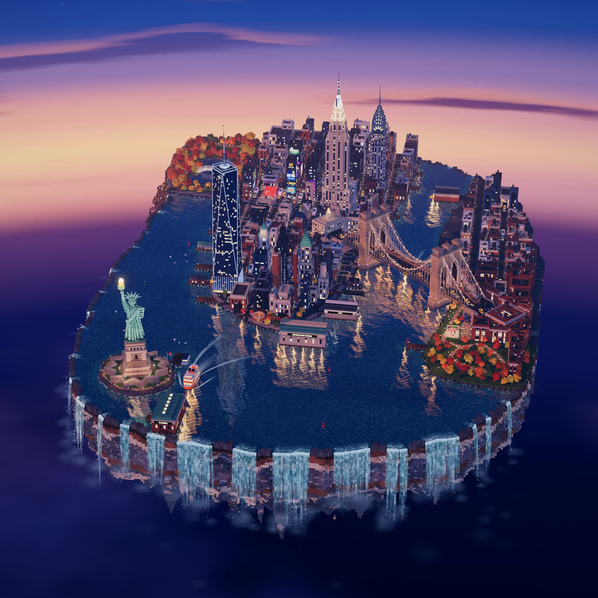
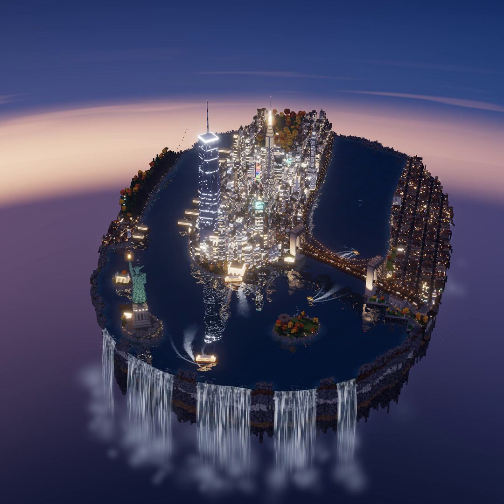

# New York

[`prompt.md`](prompt.md) asks a coding agent for an ultra-detailed voxel diorama of New York City on a floating island at blue hour. The Statue of Liberty, Lower Manhattan, the Brooklyn Bridge and a lit Empire State Building sit above layered cliffs and waterfalls, with traffic, ferries and a slow camera orbit. Each generation delivers:

- `new-york.html`: one self-contained three.js page. It plays the loop live, and with `?render=1` it exposes `renderAt(t)` to render any moment exactly.
- `new-york.mp4`: a seamless loop, 1080×1080 at 30 fps and exactly 12 seconds.
- `stills/`: frames 0, 90, 180 and 270 (t = 0, 3, 6 and 9 s) from the finished video.
- `NOTES.md`: the agent's notes on what it built, how it rendered the video, and how long it took.

Before sending the prompt, `{{FOLDER}}` is replaced with the path of an empty output folder.

## Generations

| Generation | First frame | Harness | Effort | Build time | Files |
|---|---|---|---|---|---|
| [Sonnet 5.6 (next)](generations/sonnet-5.6-next/) |  | Claude Code | xhigh | 82 min | [video](generations/sonnet-5.6-next/new-york.mp4) · [html](generations/sonnet-5.6-next/new-york.html) · [notes](generations/sonnet-5.6-next/NOTES.md) |
| [Opus 5.5 (devin)](generations/opus-5.5-devin/) |  | Devin | xhigh | 84 min | [video](generations/opus-5.5-devin/new-york.mp4) · [html](generations/opus-5.5-devin/new-york.html) · [notes](generations/opus-5.5-devin/NOTES.md) |

Build time is wall-clock time from sending the prompt to the agent's final reply. Both generations above ran at the same time on the same PC (NVIDIA GeForce RTX 4070 Ti), so they shared the GPU.

The agents also wrote build and capture scripts while they worked. Those aren't included here: `new-york.html` is the complete deliverable, and `NOTES.md` describes how each video was rendered.
