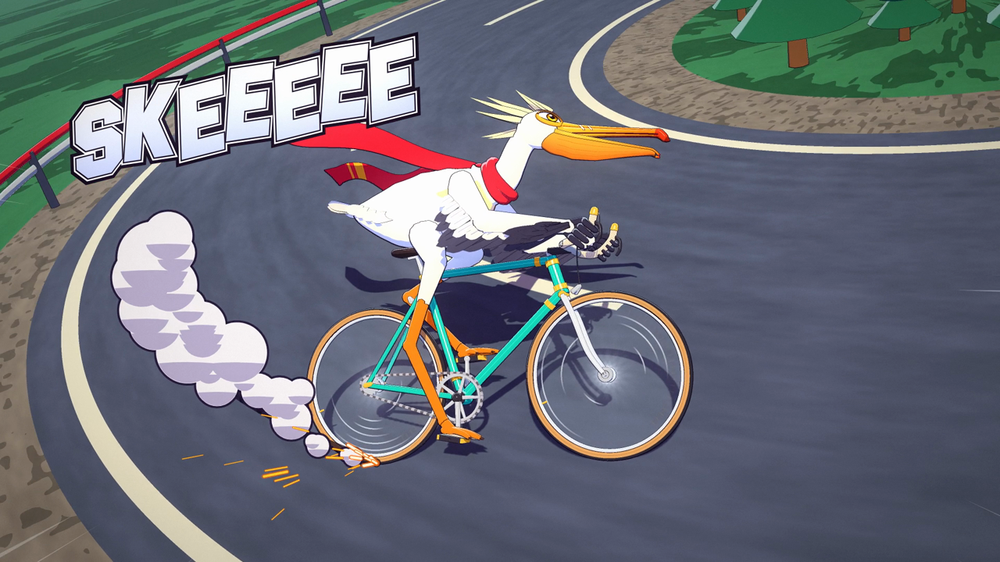

# Pelican Anime Trailer

[`prompt.md`](prompt.md) takes the "pelican riding a bicycle" meme benchmark, where most models draw a broken bike and a pelican that couldn't ride it. It asks a coding agent to turn that pelican into the hero of a 60–75 second action-anime season trailer, played completely straight. The pelican must be an original design and the riding must be physically believable: a correct diamond-frame bike, feet on the pedals turning the crank in sync with the chain and rear wheel, and wings gripping the bars. The agent has to check this on a turnaround and a pedal-cycle sheet before it animates.

The prompt suggests a shape the agent can change:
1. a cold open
2. lore cards
3. a training montage
4. a rival
5. a mountain downhill race
6. a power-up
7. a title card, then a stinger gag

The look is cel-shaded anime at 24 fps with the characters on twos. Picture, lettering, music and sound must all come from code the agent writes. No image, video, audio, font or 3D model files, TTS, generative models, network requests or third-party characters are allowed.

Each generation delivers:

- `index.html`: the trailer as one self-contained page. It exposes `window.renderAt(t)` and `window.DURATION` for frame-exact capture.
- `pelican_trailer.mp4`: the trailer at 1920×1080 and 24 fps, with a synthesized score and sound design at about −14 LUFS. There is also a smaller `pelican_trailer_x.mp4` for X.
- `character_sheet.png`: five expressions and a pedal cycle across a full crank turn.
- `contact_sheet.png` and `thumbnail.png`.
- `TREATMENT.md` and `NOTES.md`: the beats, the pelican and bike design and the music plan, plus how it renders, the checks and their numbers, and the agent's own list of weak spots.

Before sending the prompt, `{{FOLDER}}` is replaced with the path of an empty output folder.

## Generations

| Generation | Still | Harness | Effort | Build time | Files |
|---|---|---|---|---|---|
| [Sonnet 5.6 (next)](generations/sonnet-5.6-next/) |  | Claude Code (T3 Code) | xhigh | 138 min | [video](generations/sonnet-5.6-next/pelican_trailer_x.mp4) · [html](generations/sonnet-5.6-next/index.html) · [notes](generations/sonnet-5.6-next/NOTES.md) |

Build time is wall-clock time from sending the prompt to the agent's final reply.

The Sonnet 5.6 (next) generation is **BEAK VELOCITY**, 72 seconds long. A scarfed pelican falls a thousand times, then races a peregrine falcon, The Peregrine, down a mountain pass. It ignites and wins. In the stinger the beaten falcon asks "…HOW?", and the pelican's beak opens: eleven fish pour out, carried in its pouch the whole race. The agent wrote its own WebGL2 engine: the pelican, falcon and bikes are 3D meshes built from math, then given cel shading and a tapering ink pass. Because it is real 3D, the bike stays correct from every angle. The rear wheel turns exactly 2.5 times per crank turn.

The [`character_sheet.png`](generations/sonnet-5.6-next/character_sheet.png) shows the pedal cycle with measured foot-to-pedal gaps and leg reach. [`turnaround.png`](generations/sonnet-5.6-next/turnaround.png) shows the rider from eight angles. The agent's [`NOTES.md`](generations/sonnet-5.6-next/NOTES.md) lists its own weakest moments:
- The crash at 10.5–11.25 s turns into a tangle of shapes.
- In the side-by-side race at 36–38.25 s, it's hard to tell who is passing whom.
- In the "GET UP" close-up at 16.5–18 s, the wings look like jointed mannequin arms.

It also says the film reads more like cel-shaded 3D than hand-drawn anime.

The code is in [`source/`](generations/sonnet-5.6-next/source/):
- `source/tools/build.mjs` builds `index.html` from `source/src/`.
- `source/tools/cap.mjs` renders the frames and sheets.
- `source/tools/synth.mjs` synthesizes the score and sound effects in Node with no packages.
- `source/tools/finish.sh` muxes, encodes and runs the checks.

The video in the repo is the 72.6 MB copy for X, because the full-quality master (crf 16, 249 MB) is too large for GitHub.
