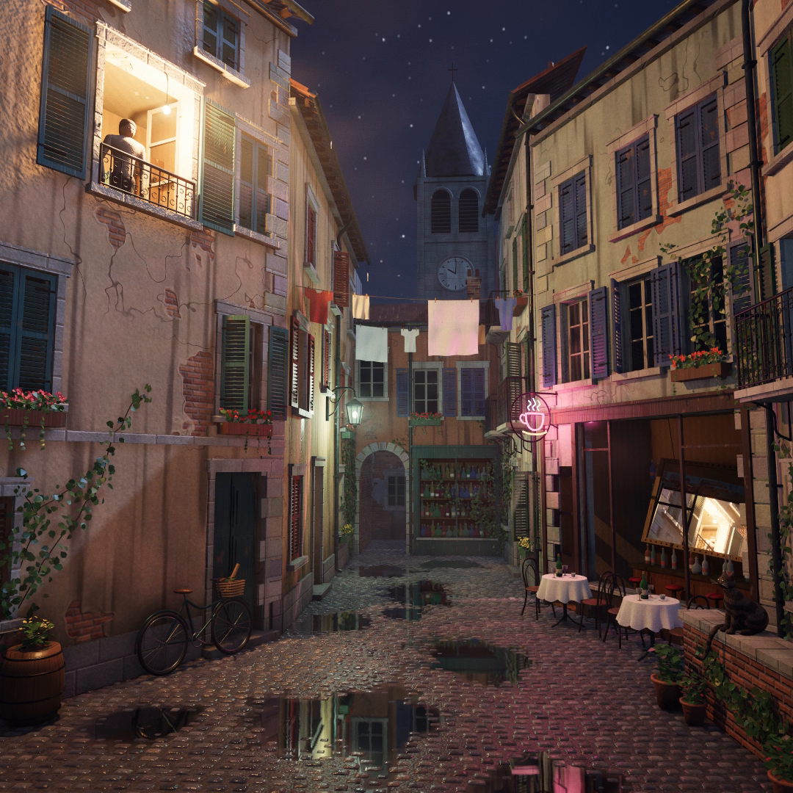

# Slow Light

[`prompt.md`](prompt.md) asks a coding agent for a physically exact "what if" film in one three.js HTML file. It's a quiet old-town street at night, in a world where light travels at only 5 metres per second. Someone switches on a lamp, and we watch the light itself crawl through the scene. The prompt asks for:
- a lit region that grows as an ellipsoid with the lamp and the camera at its two foci, not as a sphere around the lamp
- shadows that arrive with the light, and puddles and a café mirror that light up only once their longer bounce path is covered
- a glowing shell that sweeps outward through thin mist
- a switch-off that sends a front of darkness by the same rule, so the far reflections are the last thing to fade
- a soundtrack that plays with the same physics: sound travels at 343 m/s, so the switch click is heard about 2 s before the bulb is seen

The picture and the sound must be generated in code, and three.js is the only dependency allowed.

Each generation delivers:
- `slow-light.html`: the film as one self-contained page. With `?render=1` it exposes `window.renderAt(t)` for frame-exact capture.
- `slow-light.mp4`: the silent film, exactly 20.0 s (600 frames) at 1080×1080 and 30 fps. `slow-light-sound.mp4` is the same picture with the soundtrack.
- `stills/`: 4 frames from the film.
- `audio/`: the soundtrack's source and its checks.
- `NOTES.md`: the agent's notes on what it built, the techniques, the render command, the cue sheet and how long it took.

Before sending the prompt, `{{FOLDER}}` is replaced with the path of an empty output folder.

## Generations

| Generation | Still | Harness | Effort | Build time | Files |
|---|---|---|---|---|---|
| [Sonnet 5.6 (next)](generations/sonnet-5.6-next/) |  | Claude Code (T3 Code) | high (film), xhigh (sound) | 76 min | [video](generations/sonnet-5.6-next/slow-light-sound.mp4) · [html](generations/sonnet-5.6-next/slow-light.html) · [notes](generations/sonnet-5.6-next/NOTES.md) |

Build time is wall-clock time from sending the prompt to the agent's final reply. This generation got the prompt in two messages, film then sound, so its build time is the sum: 50 minutes for the film and 26 for the soundtrack (see [`generation.json`](generations/sonnet-5.6-next/generation.json)).

In the Sonnet 5.6 (next) generation, every light path uses the same lamp timing, delayed by its path length ÷ 5:
- **Direct light, shadows and mist:** the lit region is the lamp–camera ellipsoid, and the shell in the mist is solved in closed form along each view ray.
- **Reflections:** the puddles and the café mirror use a mirrored camera, which gives the exact bounce delay. The bare bulb appears in the mirror at about 4.5 s, 2.5 s after the real one (a 22.5 m path), and it is the last thing to go dark, at about 16.6 s.
- **Objects:** the figure, the cat, the moths and the drips are all posed at `t − distance / 5`, so the cat turns its head only after the light reaches it.
- **Measured, not assumed:** an audit script found the moment each of 18 test pixels switches on or off. All 18 land within 10 ms of `t_switch + path / 5`, and a frame is 33 ms. Frames re-rendered out of order are byte-identical.

The agent lists where art direction bends strict physics. The timing and geometry are never bent:
- a brief, whiter ignition flare that makes the soft edge of the front
- a mist shell brightened well beyond its physical level, which would be nearly invisible
- thinner mist near the camera
- one-bounce fill light with no shadowing
- a neon sign that lights the scene from a single point

The soundtrack is seeded synthesis in `audio/synth.mjs`, with no samples or voices. Street sounds travel at 343 m/s from where they happen, so you hear the switch, the gas lamp and the neon relay well before you see them. The score follows the light instead: each music hit starts on the first video frame that shows its event, and all eight land within 2.8 ms of frames measured from the video. The mix is −16.1 LUFS with a −1.9 dBTP peak. The agent couldn't listen to it, and says a person should before it's posted.

The code is in [`src/`](generations/sonnet-5.6-next/src/), [`tools/`](generations/sonnet-5.6-next/tools/) and [`audio/`](generations/sonnet-5.6-next/audio/):
- `tools/build.mjs` builds `slow-light.html` from `src/`.
- `tools/render.mjs` renders the film and stills.
- `tools/audit.mjs` runs the timing and determinism audit, and `audio/verify.py` checks the soundtrack.

The repo leaves out the soundtrack WAV, because `slow-light-sound.mp4` carries the same mix.
