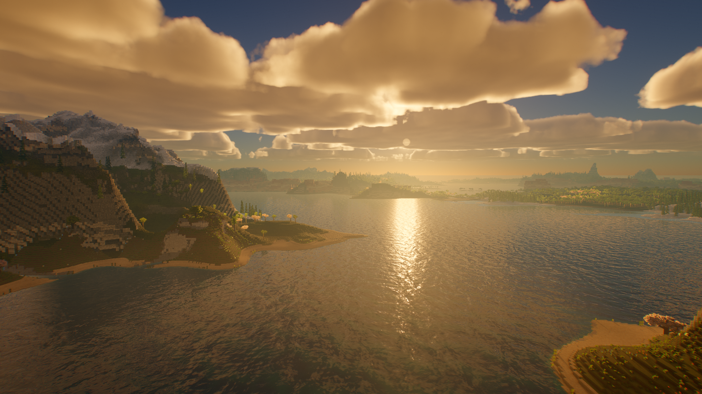

# Ultra-Realistic Blockworld

[`prompt.md`](prompt.md) asks a coding agent for a complete, playable first-person voxel sandbox game in one three.js HTML file, rendered to look photoreal. The world is still built from 1 m blocks that you can mine and place one at a time. Realism comes from materials, lighting and post-processing layered on top of the grid:

- high-resolution procedural PBR materials with parallax and bevelled block edges
- leaves you can see the sun through, and dense grass that moves in the wind
- a physically based sky with volumetric clouds and shadowed light shafts
- ocean waves, reflections and caustics
- wet surfaces in rain, snow and lightning storms
- eye-adaptation exposure when you walk out of a cave

The game itself must be real: survival and creative modes, crafting, furnaces, chests, animals and night creatures, synthesized sound, settings and saves. The game, its name, blocks and creatures must be original.

Each generation delivers:

- `blockworld.html`: the whole game as one self-contained page, with every texture, model, sound and the sky generated in code. With `?demo=1` it plays a scripted cinematic and exposes `window.renderAt(t)` for frame-exact capture.
- `blockworld.mp4`: a 30-second cinematic at 1920×1080 and 60 fps. It moves through sunrise, a forest meadow, a lava cave, a golden-hour desert, a thunderstorm and a torch-lit night.
- `stills/`: frames from the film plus gameplay screenshots with the HUD.
- `NOTES.md`: the agent's notes on what it built, the controls, the rendering techniques, the render command and how long it took.

Before sending the prompt, `{{FOLDER}}` is replaced with the path of an empty output folder.

## Generations

| Generation | Still | Harness | Effort | Build time | Files |
|---|---|---|---|---|---|
| [Sonnet 5.6 (next)](generations/sonnet-5.6-next/) |  | Claude Code (T3 Code) | xhigh | 252 min | [video](generations/sonnet-5.6-next/blockworld.mp4) · [html](generations/sonnet-5.6-next/blockworld.html) · [notes](generations/sonnet-5.6-next/NOTES.md) |

Build time is wall-clock time from sending the prompt to the agent's final reply.

The Sonnet 5.6 (next) generation is **ASHLAR**. It has 84 block types, 11 biomes, survival and creative modes, crafting, smelting, animals, night creatures and weather. Its 252-minute build time includes about 35 minutes when the session sat idle: a 2-minute accidental stop and two provider connection errors. The agent's [`NOTES.md`](generations/sonnet-5.6-next/NOTES.md) lists the controls, techniques, measured performance and its own known weak spots. Some examples:
- Frame 0 of the film is nearly black, so pick `stills/film_03.20s.png` as a thumbnail.
- Distant cliffs still show some stair-stepping.
- Streaming has rare hitches.
- Scripts tested the game; no person has played it.

The code is in [`source/`](generations/sonnet-5.6-next/source/):
- `source/build.mjs` builds `blockworld.html` from `source/src/`.
- `source/tools/capture.mjs` renders the film.
- `source/tools/t_*.mjs` are the play-test scripts the agent used.

The video in the repo is a 75 MB two-pass copy, because the full-quality master (crf 17, 122 MB) is too large for GitHub.
